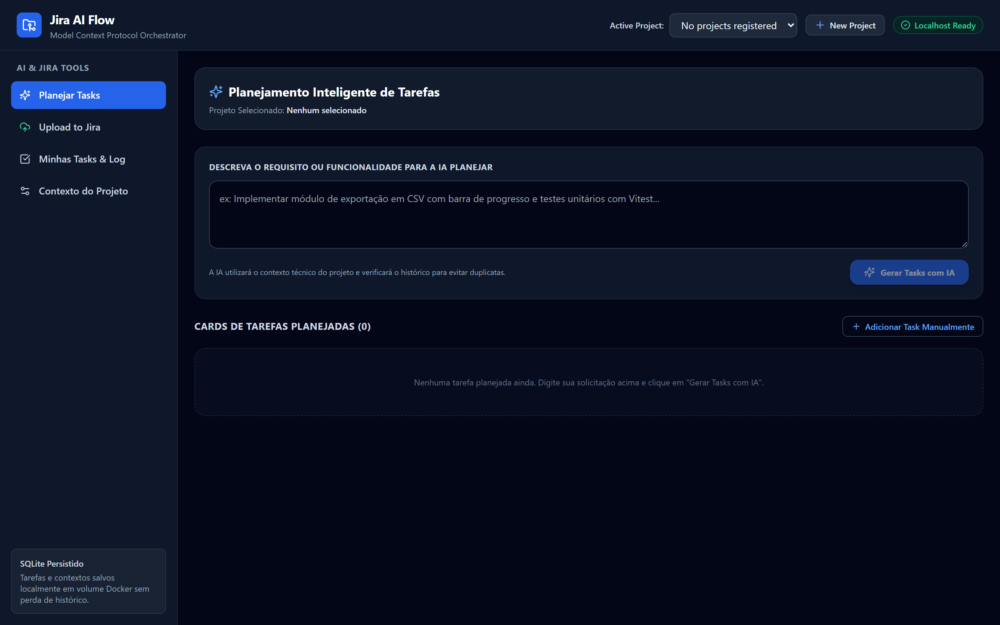
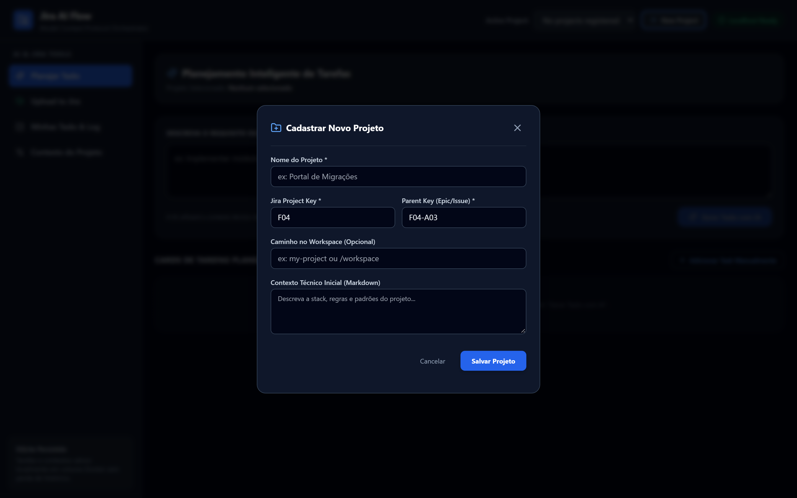
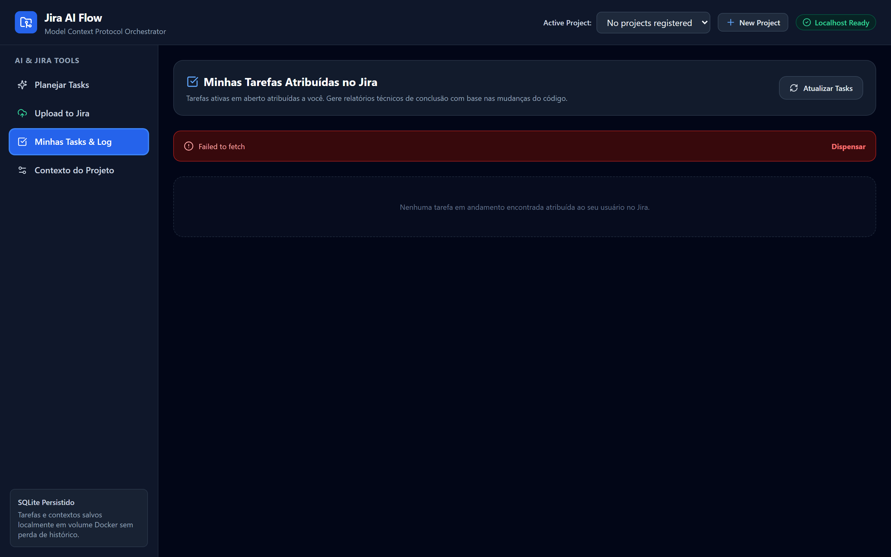
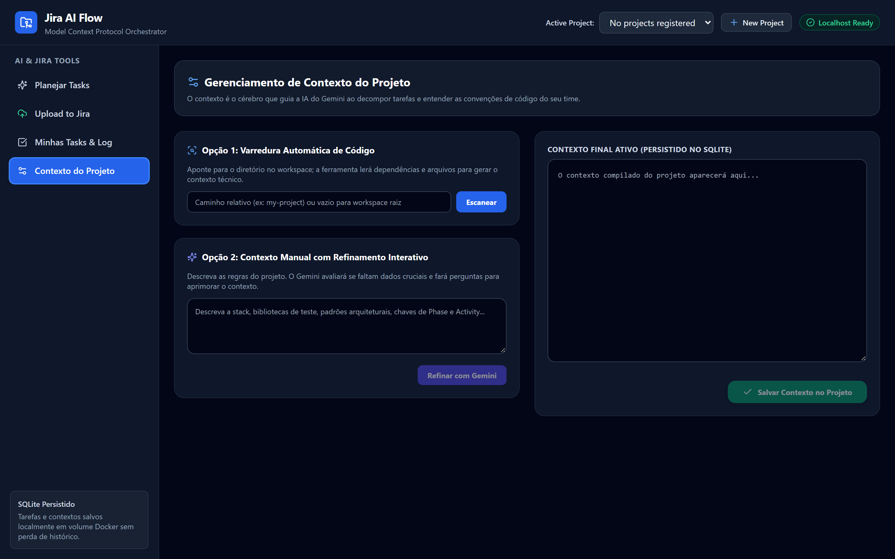

# Jira AI Flow - MCP Server & AI Task Orchestrator

A full-stack, local-first platform powered by **Google Gemini AI** and the **Model Context Protocol (MCP)** to plan Jira tasks, prevent duplicate work scopes, automate task uploads, and generate technical implementation comments from local codebases.

---

## 📸 Visual Tour & Core Features

### 1. Planejamento Inteligente de Tarefas (Task Studio)
Decomponha requisitos e funcionalidades em tarefas atômicas padronizadas pelo `TASK_CREATION_RULES.md`. A IA consulta o histórico salvo no SQLite para evitar tarefas duplicadas e apresenta cards interativos com suporte a edição manual e envio direto ao Jira Cloud.



---

### 2. Cadastro & Alternância de Múltiplos Projetos
Gerencie múltiplos projetos de software no mesmo ambiente. Cada projeto possui suas próprias chaves Jira (`JIRA_PROJECT_KEY`, `JIRA_PARENT_KEY`), caminho no workspace e contexto técnico persistido no SQLite.



---

### 3. Minhas Tarefas no Jira & Registro de Atividades (Work Logger)
Consulte as tarefas atribuídas ao seu usuário no Jira Cloud. Com um clique em **"Registrar Atividades"**, a IA inspeciona os arquivos modificados no repositório, cruza com a descrição e DoD da tarefa e redige um relatório técnico no padrão formal `COMMENT_RULES.md` para você revisar e postar no Jira.



---

### 4. Gerenciamento de Contexto Técnico & Refinamento com IA
O cérebro do projeto. Escolha entre:
1. **Varredura Automática de Código**: A IA inspeciona a árvore de diretórios e dependências para sintetizar a arquitetura.
2. **Contexto Manual com Perguntas Interativas**: Cole um resumo do projeto e o Gemini fará perguntas direcionadas para preencher lacunas antes de salvar.



---

## 🚀 Como Executar o Projeto

Você pode executar a aplicação utilizando **Podman** ou **Docker**.

### 1. Configuração do Ambiente (.env)

O arquivo [backend/.env](backend/.env) já vem pré-configurado com suas credenciais do Jira. Verifique se as seguintes variáveis essenciais estão preenchidas:

```env
# Porta e banco de dados SQLite local
PORT=3001
DATABASE_PATH=/app/data/jira_ai_orchestrator.sqlite
WORKSPACE_ROOT_PATH=/workspace

# Google Gemini AI (Obtenha gratuitamente no Google AI Studio)
GEMINI_API_KEY=sua_chave_aqui
GEMINI_MODEL=gemini-3.5-flash-lite

# Credenciais Globais do Jira Cloud
JIRA_DOMAIN=https://sua-empresa.atlassian.net
JIRA_EMAIL=seu-email@empresa.com
JIRA_API_TOKEN=seu_token_api_jira

# IDs dos campos customizados da sua instância Jira
JIRA_STORY_POINTS_FIELD_ID=customfield_10002
JIRA_PHASE_FIELD_ID=customfield_15281
JIRA_ACTIVITY_FIELD_ID=customfield_15282
JIRA_DONE_TRANSITION_ID=1071

# Modo Simulação: true protege o Jira contra alterações reais durante testes
DRY_RUN=true
```

---

### 2. Execução com Podman

O projeto inclui o manifesto OCI [compose.yaml](compose.yaml) com suporte nativo a volumes rootless e permissões SELinux (`:Z`):

```bash
# Na raiz do projeto:
podman compose up --build
```
*(Caso use o utilitário Python `podman-compose`, execute: `podman-compose up --build`)*

Para parar os containers:
```bash
podman compose down
```

---

### 3. Execução com Docker

Se preferir utilizar o Docker tradicional (Docker Desktop ou Docker Engine), o manifesto [compose.yaml](compose.yaml) é o padrão oficial OCI reconhecido nativamente pelo Docker Compose v2:

```bash
# Na raiz do projeto:
docker compose up --build
```

Para parar os containers:
```bash
docker compose down
```

---

### 4. Acessos no Navegador

Após a inicialização dos containers:
- **Interface Web (Frontend)**: [http://localhost:5173](http://localhost:5173)
- **API REST & Servidor MCP (Backend)**: [http://localhost:3001](http://localhost:3001)
- **Health Check da Aplicação**: [http://localhost:3001/api/health](http://localhost:3001/api/health)

---

## 🏗️ Destaques da Arquitetura

### Backend (`backend/`) - Clean Architecture
- **Domain**: Entidades e regras de negócio puras em TypeScript (`Project`, `JiraTask`, `TaskComment`, `HistoricalTask`).
- **Application**: Casos de uso isolados (`PlanTasksUseCase`, `UploadTasksUseCase`, `GetMyTasksUseCase`, `GenerateCommentUseCase`, `ManageProjectUseCase`).
- **Infrastructure**:
  - **SQLite Database** (`better-sqlite3`): Persistência local no volume `./data` que previne a recriação de tarefas já submetidas.
  - **Servidor MCP** (`@modelcontextprotocol/sdk`): Expõe ferramentas padronizadas (`plan_tasks`, `upload_tasks_to_jira`, `get_my_tasks`, `generate_task_comment`, `scan_project_codebase`).
  - **Google Gemini SDK** (`@google/genai`): Geração estruturada com `gemini-3.5-flash-lite`.
  - **PathResolver**: Detecção inteligente de ambiente (WSL / Docker / Podman / Windows) para mapear caminhos literais do Windows como `C:/Users/...` para `/mnt/c/Users/...` de forma transparente.

### Frontend (`frontend/`) - Strict MVVM & WCAG 2.1 AA
- **Models**: Contratos e entidades de domínio em TypeScript puro (zero dependência de React).
- **ViewModels**: Custom hooks isolados (`useTaskPlannerViewModel`, `useMyTasksViewModel`, `useProjectContextViewModel`).
- **Views**: Componentes React funcionais com suporte completo a leitores de tela, navegação por teclado (`Tab`, `Escape`) e contraste acessível.

---

## 📚 Documentação Técnica & Regras

- [Especificação da Arquitetura Backend](backend/Docs/ARCHITECTURE.md)
- [Guia de Obtenção da Chave da API do Gemini](backend/Docs/GEMINI_API_KEY_GUIDE.md)
- [Regras de Criação e Decomposição de Tarefas](backend/Docs/rules/TASK_CREATION_RULES.md)
- [Regras Formais para Relatórios de Conclusão](backend/Docs/rules/COMMENT_RULES.md)
- [Exemplos Práticos de Tarefas em Markdown](backend/Docs/examples/TASKS_EXAMPLE.md)
- [Exemplo de Contexto Técnico de Projeto](backend/Docs/examples/project-context.md)
- [Diretrizes de Arquitetura MVVM e Acessibilidade Frontend](frontend/Docs/MVVM_ARCHITECTURE.md)
- [Especificação dos Componentes da Interface](frontend/Docs/COMPONENT_SPECIFICATIONS.md)
