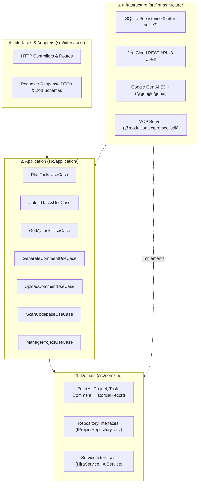

# Backend Architecture Specification (Clean Architecture & MCP)

This document describes the architectural design, patterns, and principles implemented in the `backend/` service of the Jira AI Orchestrator.

---

## 1. Architectural Style: Clean Architecture

The backend follows Uncle Bob's **Clean Architecture** to ensure separation of concerns, testability, and framework independence. Dependencies point strictly inwards:



---

## 2. Directory Structure

```text
backend/
├── src/
│   ├── config/                     # Environment configuration and validation
│   ├── domain/                     # Enterprise business rules (Zero external dependencies)
│   │   ├── entities/               # Project, JiraTask, TaskComment, HistoricalTask
│   │   ├── repositories/           # Interfaces: IProjectRepository, IHistoricalTaskRepository
│   │   └── services/               # Interfaces: IJiraService, IAIService, ICodebaseScanner
│   ├── application/                # Application business rules (Use cases)
│   │   └── use-cases/              # PlanTasks, UploadTasks, GetMyTasks, GenerateComment, etc.
│   ├── infrastructure/             # External adapters and third-party integrations
│   │   ├── database/               # SQLite connection and repository implementations
│   │   ├── jira/                   # Jira Cloud API client and ADF converter
│   │   ├── gemini/                 # Google Gen AI SDK client and agent orchestrator
│   │   └── mcp/                    # Model Context Protocol (MCP) server & tools
│   ├── interfaces/                 # Delivery mechanisms
│   │   ├── http/                   # Express/Fastify routes, controllers, error handlers
│   │   └── dtos/                   # Zod schemas and TypeScript request/response contracts
│   └── index.ts                    # Application bootstrap and composition root
├── Docs/                           # Technical documentation and guides
│   ├── rules/                      # TASK_CREATION_RULES.md, COMMENT_RULES.md
│   ├── examples/                   # TASKS_EXAMPLE.md, project-context.md, prompt.txt
│   ├── ARCHITECTURE.md             # Clean Architecture & MCP Specification
│   └── GEMINI_API_KEY_GUIDE.md     # Google AI Studio API key guide
├── legacy/                         # Archived create-jira-tasks.ts CLI script
├── .env.example                    # Environment variable template
├── tsconfig.json                   # TypeScript compiler configuration
└── package.json                    # Project dependencies and build scripts
```

---

## 3. The Model Context Protocol (MCP) Integration

The backend implements an MCP Server using `@modelcontextprotocol/sdk`. This exposes the system's operational capabilities as standardized tools callable both by the embedded Gemini AI Agent and by external MCP clients (e.g., Claude Desktop, IDEs, CLI tools).

### Registered MCP Tools:

| Tool Name | Scope | Description |
| :--- | :--- | :--- |
| `plan_tasks` | Task Generation | Plans structured tasks based on project context, code scans, and `TASK_CREATION_RULES`. Checks historical tasks to prevent duplicate scopes. |
| `upload_tasks_to_jira` | Jira Integration | Submits approved tasks to Jira Cloud REST API v3, setting custom fields (Story Points, Phase, Activity) and transitioning states. |
| `get_my_tasks` | Jira Query | Retrieves active tasks assigned to the current user via JQL query. |
| `scan_project_codebase` | Code Analysis | Inspects local files in `/workspace` to extract architecture metadata and understand code changes for a specific task. |
| `generate_task_comment` | AI Generation | Analyzes code changes and DoD to generate a standardized technical completion report following `COMMENT_RULES`. |
| `upload_comment_to_jira` | Jira Integration | Posts a generated ADF comment to a specific Jira issue. |

---

## 4. Deduplication & Persistence Architecture

A mounted volume (`./data:/app/data`) hosts the SQLite database `jira_ai_orchestrator.sqlite`.

### Key Tables:
1. **`projects`**:
   - `id`: UUID primary key.
   - `name`: Human-readable project name.
   - `jira_project_key`: Jira Project identifier (e.g., `F04`).
   - `jira_parent_key`: Default parent epic/issue (e.g., `F04-A03`).
   - `root_path`: Relative or absolute path in `/workspace`.
   - `context_markdown`: Synthesized technical context.
   - `created_at` / `updated_at`: Timestamps.

2. **`historical_tasks`**:
   - `id`: UUID primary key.
   - `project_id`: Foreign key referencing `projects(id)`.
   - `task_number`: Numeric identifier (e.g. `[01]`).
   - `summary`: Task title/summary.
   - `jira_issue_key`: Assigned key (e.g., `F04-123`).
   - `dod`: Serialized Definition of Done.
   - `status`: `OPEN` | `DONE`.
   - `uploaded_at`: Timestamp.

When `plan_tasks` executes, the AI agent prompts include all summaries from `historical_tasks` for the active project, explicitly instructing the model to reject creating overlapping scopes.

---

## 5. Security, Network & Hybrid Filesystem Resolution

- **Cross-Platform Path Resolution (WSL / Windows / Podman / Docker)**:
  - Through `PathResolver`, the backend automatically detects whether it is running inside **Podman / Docker** (`/.containerenv` or `/.dockerenv`), native **WSL2** (`os.release().includes('wsl')`), or **Windows** (`win32`).
  - When a user passes a literal Windows path (e.g. `C:/Users/example` or `C:\projects\app`), Podman / Docker mounts `c:/:/mnt/c:ro`, and `PathResolver` translates the drive path seamlessly to `/mnt/c/Users/example`.
- **Secrets Handling**: Zero credentials stored in code or database; strictly read from environment variables (`process.env`).
- **Read-Only Mounts**: Host drives and workspace folders are mounted as read-only (`:ro`) to avoid accidental file mutations by AI code scanners.
- **Dry-Run Mode**: Supports `DRY_RUN=true` to test full workflows without mutating Jira Cloud data.
