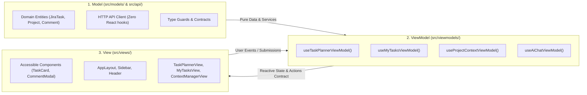

# Frontend Architecture Specification: Strict MVVM & WCAG 2.1 AA

This document establishes the architecture, patterns, and accessibility guidelines for the Jira AI Orchestrator Web Application (`frontend/`).

---

## 1. Architectural Pattern: Model-View-ViewModel (MVVM)

The frontend enforces strict separation of concerns across three distinct layers:



---

## 2. Layer Responsibilities & Constraints

### 2.1. Model Layer (`src/models/`, `src/api/`)
- **Rules**:
  - Pure TypeScript only.
  - **Zero React dependencies** (no hooks, no JSX, no UI state).
  - Encapsulates domain entities (`Project`, `JiraTask`, `TaskComment`), DTO mappings, and API fetch calls.
  - Runtime validation using TypeScript type guards.

### 2.2. ViewModel Layer (`src/viewmodels/`)
- **Rules**:
  - Implemented as custom React hooks (e.g., `useTaskPlannerViewModel`).
  - Manages presentation state, asynchronous side effects, validations, and action callbacks.
  - **Zero JSX, zero HTML rendering, zero CSS/styling logic**.
  - Exposes a strictly typed contract:
    - `state`: Reactive values and derived state flags (`isLoading`, `hasError`, `tasks`, `selectedProject`).
    - `actions`: Stable callback functions (`onSelectProject`, `onUpdateTaskCard`, `onUploadToJira`, `onGenerateComment`).
  - 100% testable in isolation using `@testing-library/react` (`renderHook`).

### 2.3. View Layer (`src/views/`)
- **Rules**:
  - Pure React functional components (`.tsx`).
  - Consumes ViewModel hooks or receives contracts via props.
  - **Zero direct business logic, zero raw API calls**.
  - Styled with modular, scoped **CSS Modules (`*.module.css`)** and design system variables defined in `src/index.css`. Zero runtime CSS overhead, zero utility-class leakage.
  - Focuses strictly on semantic layout, keyboard interaction, and accessible presentation.
  - Visual indicators for AI operations (e.g. codebase scanning, context refinement) are rendered with accessible ARIA live states (`role="status"`, `aria-live="polite"`).

---

## 3. Mandatory Accessibility Standards (WCAG 2.1 AA+)

All UI components comply with WCAG 2.1 AA:

1. **Semantic HTML Structure**:
   - Primary landmark elements: `<header>`, `<nav>`, `<main>`, `<aside>`, `<footer>`.
   - Native interactive elements: `<button>`, `<input>`, `<select>`, `<dialog>`. Never use clickable `<div>` or `<span>`.
2. **Accessible Names & Form Association**:
   - Every input has a corresponding `<label htmlFor="...">`.
   - Icon-only buttons include descriptive `aria-label` attributes (e.g., `aria-label="Edit Task #01"`).
3. **ARIA Live Regions**:
   - Asynchronous AI status and task upload progress are announced via `aria-live="polite"` or `role="status"`.
   - Critical errors use `role="alert"`.
4. **Keyboard Navigation & Visible Focus**:
   - Full keyboard accessibility (Tab, Shift+Tab, Enter, Space, Escape).
   - High-contrast `:focus-visible` outlines are strictly preserved across all interactive controls.
5. **Form Error Feedback**:
   - Invalid form inputs are marked with `aria-invalid={true}` and linked to error descriptions using `aria-describedby`.

---

## 4. Directory Structure

```text
frontend/
├── src/
│   ├── models/                    # Pure TypeScript models, contracts, DTOs
│   │   ├── Project.ts
│   │   ├── JiraTask.ts
│   │   ├── TaskComment.ts
│   │   └── ApiResponse.ts
│   ├── api/                       # HTTP API client implementations
│   │   ├── projectApiClient.ts
│   │   ├── taskApiClient.ts
│   │   └── aiApiClient.ts
│   ├── viewmodels/                # Custom React ViewModel hooks
│   │   ├── useProjectContextViewModel.ts
│   │   ├── useTaskPlannerViewModel.ts
│   │   ├── useMyTasksViewModel.ts
│   │   └── useAiChatViewModel.ts
│   ├── views/                     # React Functional Components (JSX)
│   │   ├── components/            # Reusable UI elements (TaskCard, CommentDialog, etc.)
│   │   ├── layout/                # AppLayout, Sidebar, Header
│   │   ├── TaskPlannerView.tsx    # Interactive task planning and cards view
│   │   ├── MyTasksView.tsx        # Assigned Jira tasks and comment logger view
│   │   └── ProjectContextView.tsx # Project context registration and AI Q&A view
│   ├── App.tsx                    # Root application component
│   └── main.tsx                   # Application DOM bootstrap
├── Docs/                          # Technical documentation
├── public/                        # Static assets
├── Dockerfile                     # Production Nginx container
├── nginx.conf                     # Nginx SPA routing and caching configuration
├── index.html                     # HTML5 entrypoint
├── tsconfig.json                  # TypeScript configuration
└── package.json                   # Dependencies and scripts
```
